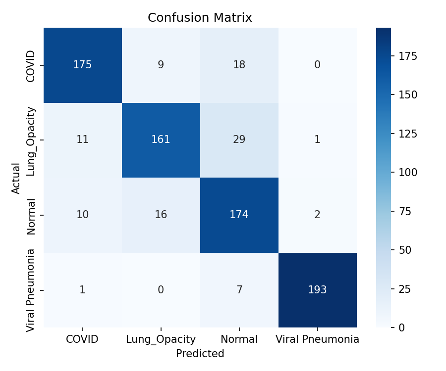
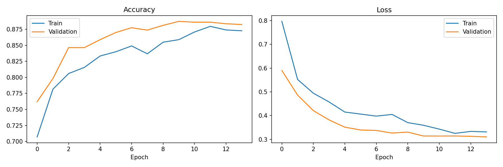

# 🫁 Multiple Chest Disease Prediction using Deep Learning

A deep learning project that predicts a disease from a chest X-ray image. Upload an X-ray and the model classifies it into one of four classes: **COVID-19, Lung Opacity, Normal, or Viral Pneumonia**. The model is wrapped in a simple web app built with Streamlit.

> **Disclaimer:** This is an academic mini project made for learning. It is **not** a medical device and must **not** be used for real diagnosis.

**Live demo:** [your-app-name.streamlit.app](https://your-app-name.streamlit.app) *(replace with your link after deployment)*


---

## Table of Contents

- [Features](#features)
- [How it works](#how-it-works)
- [Tech stack](#tech-stack)
- [Dataset](#dataset)
- [Model and training](#model-and-training)
- [Results](#results)
- [Project structure](#project-structure)
- [Installation and usage](#installation-and-usage)
- [Deployment](#deployment)
- [Limitations](#limitations)
- [Future scope](#future-scope)
- [References](#references)
- [Author](#author)

---

## Features

- Upload a chest X-ray (PNG or JPG) and get an instant prediction
- Shows the predicted disease with a **confidence** percentage
- Shows the probability for all four classes
- Simple explanation of what the predicted condition means
- Warning when the model is not very sure about an image
- "About the model" section with test accuracy and the confusion matrix

## How it works


1. The user uploads a chest X-ray image.
2. The image is converted to RGB and resized to 224 x 224.
3. Rescaling and normalization are built into the model, so the app uses exactly the same preprocessing as training.
4. DenseNet121 (pretrained on ImageNet) extracts features, and our classifier head outputs 4 probabilities using softmax.
5. The class with the highest probability is shown as the prediction.

## Tech stack

| Area | Technology |
|---|---|
| Language | Python |
| Deep learning | TensorFlow / Keras, DenseNet121 |
| Data handling | NumPy, Pandas |
| Evaluation and graphs | Scikit-learn, Matplotlib, Seaborn |
| Image handling | Pillow |
| Web app | Streamlit |
| Training platform | Kaggle Notebook (GPU) |

## Dataset

- **Name:** COVID-19 Radiography Database (Kaggle)
- **Link:** https://www.kaggle.com/datasets/tawsifurrahman/covid19-radiography-database
- **Full dataset:** 21,165 chest X-ray images in 4 classes

| Class | Images in full dataset | Images used |
|---|---|---|
| COVID-19 | 3,616 | 1,345 |
| Lung Opacity | 6,012 | 1,345 |
| Normal | 10,192 | 1,345 |
| Viral Pneumonia | 1,345 | 1,345 |
| **Total** | 21,165 | **5,380** |

The full dataset is imbalanced, so an equal number of images (1,345, the size of the smallest class) was randomly taken from each class.

**Split (stratified):** 70% training (3,766 images), 15% validation (807 images), 15% testing (807 images).

## Model and training

**Architecture (transfer learning):**

```
Input (224 x 224 x 3)
  -> Data augmentation (rotation, zoom, contrast; training only)
  -> Rescaling + ImageNet normalization
  -> DenseNet121 (pretrained on ImageNet, no top layer)
  -> Global Average Pooling
  -> Batch Normalization
  -> Dropout (0.4)
  -> Dense (128, ReLU)
  -> Dropout (0.3)
  -> Dense (4, Softmax)
```

**Training was done in two phases:**

| Setting | Phase 1: train the new head | Phase 2: fine-tune |
|---|---|---|
| DenseNet121 layers | Frozen | Last 40 layers unfrozen (BatchNorm kept frozen) |
| Learning rate | 0.001 | 0.00001 |
| Maximum epochs | 10 | 8 |
| Optimizer | Adam | Adam |
| Batch size | 32 | 32 |
| Loss | Sparse categorical cross-entropy | Sparse categorical cross-entropy |

Callbacks used: `EarlyStopping`, `ReduceLROnPlateau`, `ModelCheckpoint`. The model was trained on a Kaggle GPU.

## Results

**Test accuracy: 87.11%** (703 of 807 unseen images classified correctly)

| Class | Precision | Recall | F1-score | Test images |
|---|---|---|---|---|
| COVID-19 | 88.8% | 86.6% | 87.7% | 202 |
| Lung Opacity | 86.6% | 79.7% | 83.0% | 202 |
| Normal | 76.3% | 86.1% | 80.9% | 202 |
| Viral Pneumonia | 98.5% | 96.0% | 97.2% | 201 |
| **Macro average** | 87.5% | 87.1% | 87.2% | 807 |

**Confusion matrix** (rows = actual class, columns = predicted class):

| Actual \ Predicted | COVID-19 | Lung Opacity | Normal | Viral Pneumonia |
|---|---|---|---|---|
| **COVID-19** | 175 | 9 | 18 | 0 |
| **Lung Opacity** | 11 | 161 | 29 | 1 |
| **Normal** | 10 | 16 | 174 | 2 |
| **Viral Pneumonia** | 1 | 0 | 7 | 193 |





**Observations:**
- Viral Pneumonia is predicted best (193 of 201 correct).
- Most mistakes happen between **Lung Opacity and Normal**, which look very similar on X-rays.

## Project structure

```
chest-disease-prediction/
├── app.py                        # Streamlit web app
├── chest_disease_training.ipynb  # Training notebook (Kaggle)
├── chest_disease_model.keras     # Trained model
├── class_names.json              # Class names used by the app
├── requirements.txt              # Python dependencies
├── confusion_matrix.png          # Test-set confusion matrix
├── training_curves.png           # Accuracy and loss curves
├── screenshots/
│   └── app.png                   # App screenshot used in this README
└── README.md
```

## Installation and usage

**Requirements:** Python 3.10, 3.11 or 3.12 (64-bit). TensorFlow does not support very new Python versions, so use 3.11 if you are unsure.

```bash
# 1. Clone the repository
git clone https://github.com/<your-username>/chest-disease-prediction.git
cd chest-disease-prediction

# 2. Create and activate a virtual environment (Windows)
py -3.11 -m venv venv
venv\Scripts\activate

# On macOS / Linux
# python3.11 -m venv venv
# source venv/bin/activate

# 3. Install dependencies
pip install -r requirements.txt

# 4. Run the app
streamlit run app.py
```

The app opens at `http://localhost:8501`.

> If the model fails to load, install the same TensorFlow version that was used for training, for example `pip install tensorflow==2.18.0`.

### Retraining the model

1. Open `chest_disease_training.ipynb` in a Kaggle Notebook.
2. Add the **COVID-19 Radiography Database** dataset and turn on a **GPU**.
3. Run all cells from top to bottom.
4. Download `chest_disease_model.keras` and `class_names.json` and place them next to `app.py`.

## Deployment

The app can be hosted for free on **Streamlit Community Cloud**:

1. Push this repository to GitHub (use `git push` or GitHub Desktop for the model file, because the browser upload limit is 25 MB).
2. Go to [share.streamlit.io](https://share.streamlit.io) and sign in with GitHub.
3. Click **Create app**, choose this repository, set the main file to `app.py`, and set the Python version to **3.11**.
4. On the free server, use `tensorflow-cpu` in `requirements.txt` to save memory.

## Limitations

- Only 4 classes, and only one label per image
- Trained on a balanced subset (5,380 images) of one public dataset
- Not clinically validated, so results may differ on X-rays from other hospitals or machines
- Lung Opacity and Normal are often confused

## Future scope

- Train on the full dataset with class weights
- Compare more models (ResNet50, EfficientNet, Vision Transformers)
- Add more diseases such as tuberculosis, lung cancer and pneumothorax
- Add Grad-CAM heatmaps to explain predictions
- Deploy as a public website or mobile app

## References

1. Huang, G., Liu, Z., van der Maaten, L., and Weinberger, K. Q. (2017). *Densely Connected Convolutional Networks.* IEEE CVPR.
2. Chowdhury, M. E. H., et al. (2020). *Can AI Help in Screening Viral and COVID-19 Pneumonia?* IEEE Access, 8, 132665-132676.
3. Rahman, T., et al. (2021). *Exploring the Effect of Image Enhancement Techniques on COVID-19 Detection Using Chest X-ray Images.* Computers in Biology and Medicine, 132, 104319.
4. Pan, S. J., and Yang, Q. (2010). *A Survey on Transfer Learning.* IEEE Transactions on Knowledge and Data Engineering, 22(10), 1345-1359.
5. COVID-19 Radiography Database, Kaggle: https://www.kaggle.com/datasets/tawsifurrahman/covid19-radiography-database

## Author

**Prashant**, MCA
